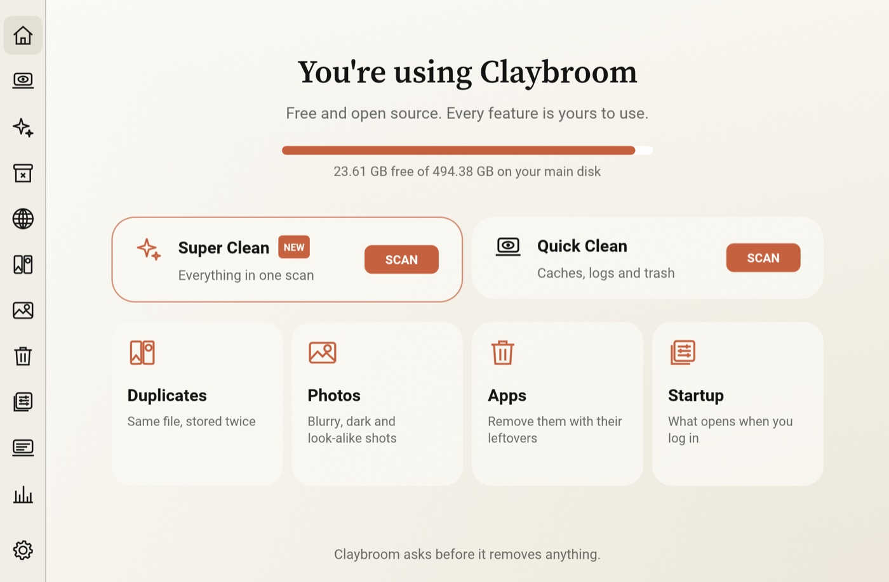
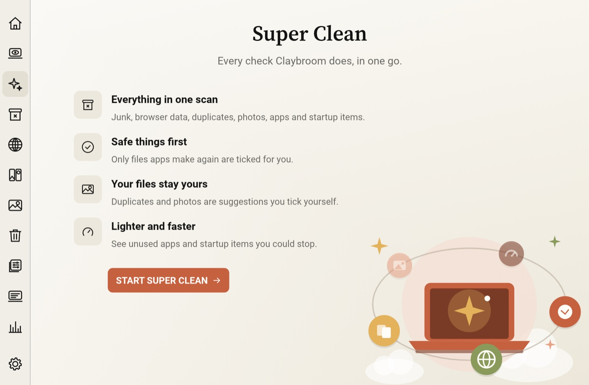
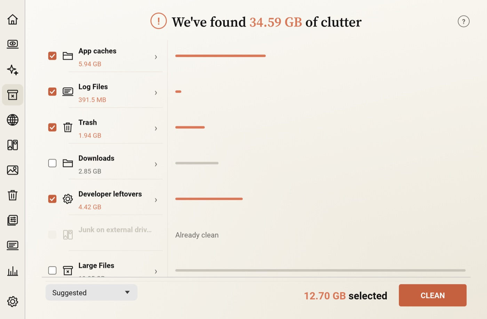
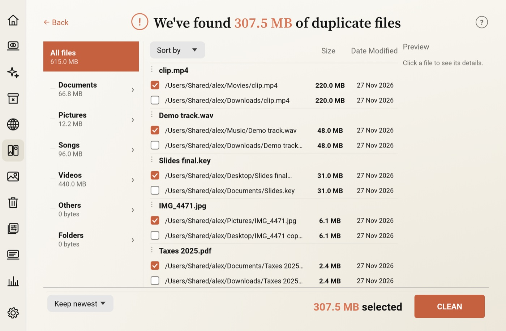
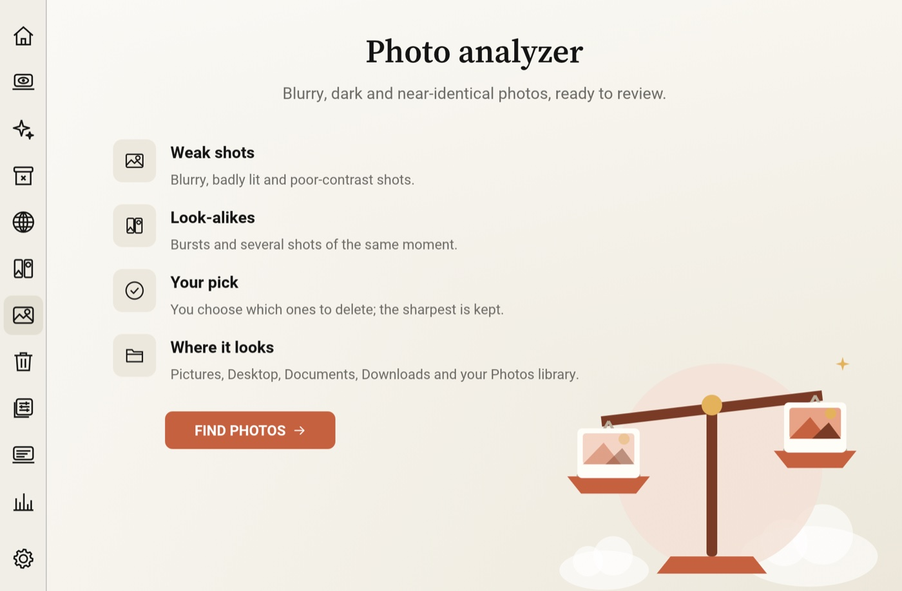
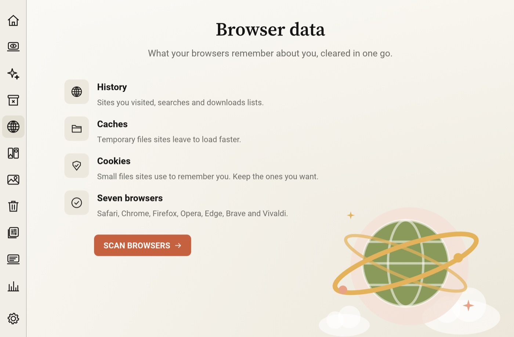
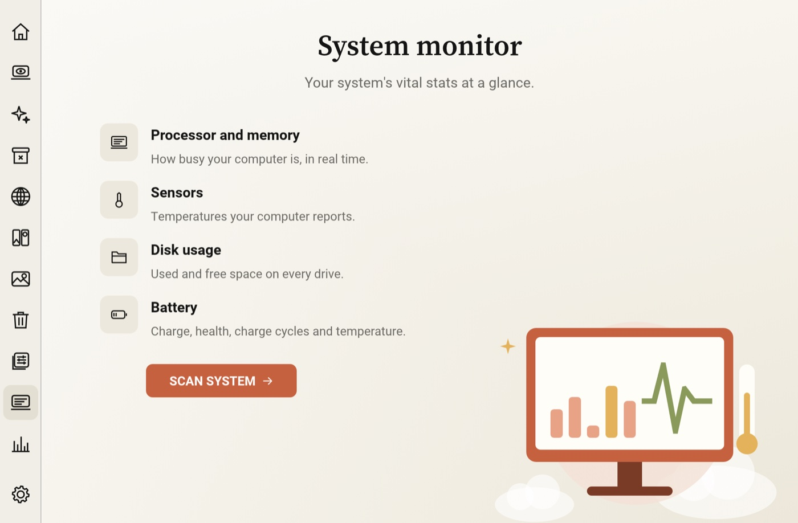
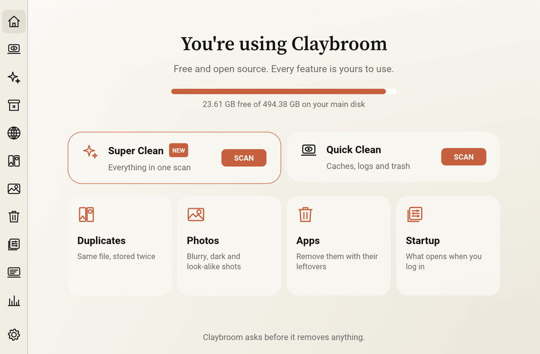

<div align="center">


# Claybroom

**A free, open-source disk cleaner for macOS, Windows and Linux.**<br>
Clear junk, find duplicates and weak photos, and remove apps with their leftovers.<br>
No subscription, no account, no tracking.

[](https://github.com/SherifMoShalaby/claybroom/releases/latest)
[](https://github.com/SherifMoShalaby/claybroom/actions/workflows/release.yml)
[](https://github.com/SherifMoShalaby/claybroom/releases)
[](LICENSE)
<br>


[**Download**](#download) · [Features](#features) · [Safety](#safety-and-privacy) · [Build from source](#build-from-source) · [FAQ](#faq)

<br>

<picture>
  <source media="(prefers-color-scheme: dark)" srcset="docs/images/home-dark.jpg">
  
</picture>

</div>

## Why Claybroom

- **Every feature is free.** Scheduled cleaning, a cookie allowlist, photo analysis and the uninstaller aren't locked behind a paywall.
- **It asks before it removes anything.** Only junk that apps rebuild is ticked for you; personal files are suggestions, and they go to the Trash.
- **It stays on your computer.** No telemetry, no ads, no account. The only network request is an update check, and it's off by default. (If you connect an AI tool, what it reads goes to that tool.)
- **One native app on three systems.** Written in Rust with [egui](https://github.com/emilk/egui), with light and dark looks that follow your system.

## Features

<table>
<tr>
<td width="50%" valign="top">

<picture>
  <source media="(prefers-color-scheme: dark)" srcset="docs/images/super-dark.jpg">
  
</picture>

### Super Clean
One scan for junk, browser data, duplicates, photos, unused apps and startup items. Results come in two lanes: **safe to clean now**, and **your call** for anything personal.

</td>
<td width="50%" valign="top">

<picture>
  <source media="(prefers-color-scheme: dark)" srcset="docs/images/clutter-dark.jpg">
  
</picture>

### Clean clutter
App caches, logs, the Trash, old downloads, developer leftovers (Xcode, npm), junk on external drives and large files, sorted by size.

</td>
</tr>
<tr>
<td width="50%" valign="top">

<picture>
  <source media="(prefers-color-scheme: dark)" srcset="docs/images/duplicates-dark.jpg">
  
</picture>

### Find duplicates
Files and whole folders with identical content (BLAKE3), grouped by type. Keep the newest or the oldest copy with one click.

</td>
<td width="50%" valign="top">

<picture>
  <source media="(prefers-color-scheme: dark)" srcset="docs/images/photos-dark.jpg">
  
</picture>

### Analyze photos
Blurry, too dark or bright, low-contrast and look-alike shots, including HEIC and your Photos library on macOS. The sharpest is always kept.

</td>
</tr>
<tr>
<td width="50%" valign="top">

<picture>
  <source media="(prefers-color-scheme: dark)" srcset="docs/images/browser-dark.jpg">
  
</picture>

### Clean browsers
Caches, history and cookies of Safari, Chrome, Firefox, Opera, Edge, Brave and Vivaldi. Schedule it, keep the sites you stay signed in to, or only delete history older than a set age.

</td>
<td width="50%" valign="top">

<picture>
  <source media="(prefers-color-scheme: dark)" srcset="docs/images/monitor-dark.jpg">
  
</picture>

### System monitor
CPU, memory, temperatures, fans, graphics, disks and battery, also in a small panel from the menu bar or system tray.

</td>
</tr>
</table>

**And more:** Quick Clean for caches, logs and the Trash in one pass · an app uninstaller that removes leftovers · a startup manager · statistics of what you've cleaned · a "Find duplicates with Claybroom" item on folders' right-click menu.

<details>
<summary><b>See a quick tour</b></summary>
<br>
<p align="center"></p>
</details>

## Download

Get the latest version from the **[Releases page](https://github.com/SherifMoShalaby/claybroom/releases/latest)**.

| Platform | File | First run |
|---|---|---|
| **macOS** (Apple silicon and Intel) | `Claybroom-v<version>.dmg` | Drag Claybroom to Applications. The first time, right-click it › **Open**. |
| **Windows** (64-bit) | `Claybroom-v<version>-windows-x64.exe` | If SmartScreen asks: **More info › Run anyway**. |
| **Linux** (x64) | `Claybroom-v<version>-linux-x64.tar.gz` | Extract and run `claybroom`. The tray icon needs GTK 3 and libayatana-appindicator3. |

> [!TIP]
> On macOS, allow Claybroom in **System Settings › Privacy & Security › Full Disk Access** so it can see the Trash, Mail downloads and every browser. The app walks you through it on first launch.

## Use with AI tools (MCP)

Claybroom can answer questions from AI tools like Claude Code, Claude Desktop, Codex and Cursor through the [Model Context Protocol](https://modelcontextprotocol.io): "what's taking space?", "which duplicates can go?". It's **read-only for now**: the AI can scan and list, and you clean in the Claybroom window.

```sh
# Claude Code (macOS)
claude mcp add --transport stdio --scope user claybroom -- /Applications/Claybroom.app/Contents/MacOS/claybroom --mcp
```

For Claude Desktop, Codex or Cursor, point the tool at the same command: `claybroom --mcp`.

- **Privacy:** by default the AI sees file names and `~/`-relative locations. Add `--privacy minimal` for sizes and counts only, or `--privacy full` for absolute paths. Whatever it sees goes to the AI tool's model.
- **macOS:** the scan runs with the AI tool's permissions, so without Full Disk Access for that tool (Terminal, Claude…), the Trash, Mail downloads and some browser data stay hidden. Claybroom says so in its results.
- The design, including the planned safe-cleaning tools, is in [`docs/mcp-design.md`](docs/mcp-design.md).

## Safety and privacy

- Nothing is removed without a confirmation.
- Personal files (downloads, large files, duplicates, photos) go to the **Trash**; only regenerable junk is deleted for good.
- System folders are never touched, symbolic links are never followed, and saved passwords are never ticked for you.
- A running browser is skipped until you close it.
- The exact rules (which folders, which limits, what's ticked by default) are written down in [`MECHANICS.md`](MECHANICS.md) and checked by the test suite.

## Build from source

You need [Rust](https://rustup.rs) (stable). On Linux, also the GTK 3 and appindicator development packages (see [`release.yml`](.github/workflows/release.yml)).

```sh
git clone https://github.com/SherifMoShalaby/claybroom.git
cd claybroom
cargo run --release
```

| Command | What it does |
|---|---|
| `cargo test` | Unit tests, plus a check that [`mechanics.json`](mechanics.json) matches what the build actually does |
| `cargo test -- --ignored --nocapture` | Read-only scans of your real computer |
| `claybroom --page <name>` | Opens a screen directly: `quick`, `clutter`, `browser`, `duplicates`, `photos`, `apps`, `startup`, `monitor`, `stats`, `settings`, `tray` |
| `claybroom --screenshot out.png` | Saves a picture of the window and exits |
| `sh packaging/macos-dmg.sh` | Builds a universal macOS app and disk image into `dist/` |

Releases are built by GitHub Actions when a tag like `v0.1.0` is pushed.

## FAQ

<details>
<summary><b>macOS says Claybroom "can't be opened" or is from an unidentified developer.</b></summary>
<br>
The app isn't notarised by Apple yet. Right-click Claybroom in Applications › <b>Open</b>, then confirm. You only need to do this once.
</details>

<details>
<summary><b>Windows shows a SmartScreen warning.</b></summary>
<br>
The program isn't code-signed yet. Click <b>More info › Run anyway</b>.
</details>

<details>
<summary><b>Why does it want Full Disk Access on macOS?</b></summary>
<br>
Without it, macOS hides the Trash, Mail downloads and some browser folders from every app, so Claybroom would find less. It reads those folders only to show you what can be cleaned.
</details>

<details>
<summary><b>Does it phone home?</b></summary>
<br>
No. The only network request is the optional update check (Settings › General, off by default), which asks this repository's releases for a newer version.
</details>

## Contributing

Bug reports and pull requests are welcome; see [**CONTRIBUTING.md**](CONTRIBUTING.md) for how to build, the rules every change keeps, and how to send a pull request. To report a bug or suggest a feature, [open an issue](https://github.com/SherifMoShalaby/claybroom/issues/new/choose). Windows and Linux testers are especially helpful right now.

## Licence

[MIT](LICENSE). Bundled fonts: Roboto (Apache 2.0) and Source Serif 4 (SIL OFL 1.1); see [`assets/FONTS-LICENSE.txt`](assets/FONTS-LICENSE.txt).
